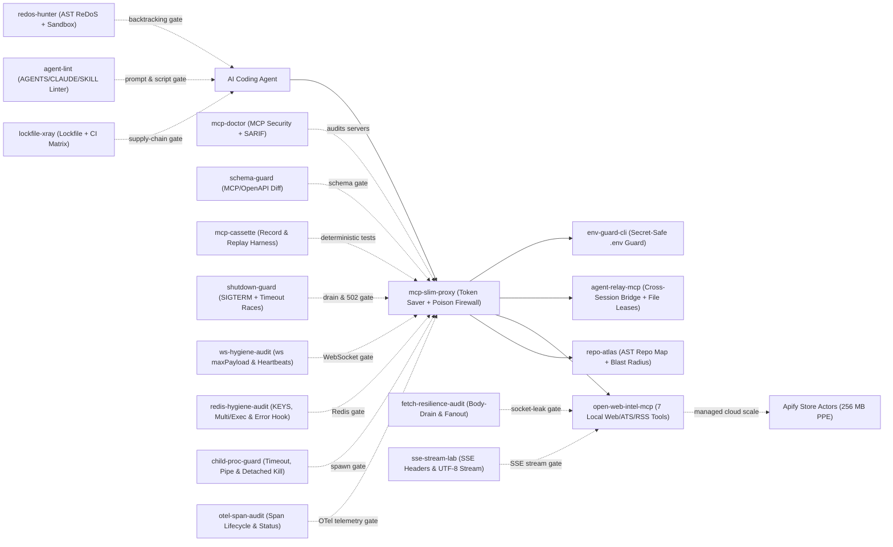

# Pakatorn Jongsirikul (`@pie527645-cloud`)

Full-stack TypeScript & Automation Developer building open-source **Model Context Protocol (MCP)** infrastructure, **local coding-agent QoL tooling**, **direct-API web data extractors** (`256 MB`, zero residential proxies), and **n8n automation workflows**.



---

## Open-Source MCP & Coding Agent Suite

| Repository | Problem Solved | Key Highlights |
| :--- | :--- | :--- |
| **[repo-atlas](https://github.com/pie527645-cloud/repo-atlas)** | Eliminates 15-call agent orientation tax & blind edits | TypeScript Compiler API AST map within token budget, Tarjan cycle detection, `--relative -z` git blast radius, CI drift check, 3 read-only MCP tools |
| **[mcp-slim-proxy](https://github.com/pie527645-cloud/mcp-slim-proxy)** | Stops 40K+ MCP tool-schema bloat & prompt injection | Multiplexes N stdio servers behind **4 lean meta-tools (`~739` tokens)**, BM25 lazy search, out-of-context `run_pipeline`, fail-closed poisoning quarantine |
| **[agent-relay-mcp](https://github.com/pie527645-cloud/agent-relay-mcp)** | Multi-agent edit collisions & terminal stdin hijacking | Zero-native atomic local store, cooperative TTL file leases, monotonic cross-session channels, non-blocking human Q&A inbox + `127.0.0.1` web UI |
| **[mcp-doctor](https://github.com/pie527645-cloud/mcp-doctor)** | Exposed secrets, tool poisoning & broken schemas in MCP | Zero runtime deps, audits configs + live stdio/HTTP servers, Context Token Tax breakdown, valid **SARIF 2.1.0** for GitHub Code Scanning |
| **[env-guard-cli](https://github.com/pie527645-cloud/env-guard-cli)** | Secret leaks, `.env` drift & agent reading `.env` raw | Zero runtime deps, polyglot TS/JS/Py/Go/Rust scanner, `.env.schema.json` validator, scrubbed `sync --write-example`, 3 secret-safe MCP tools, **SARIF 2.1.0** |
| **[schema-guard](https://github.com/pie527645-cloud/schema-guard)** | Silent breaking changes in MCP tools & OpenAPI contracts | Deterministic diff for `mcp tools/list`, OpenAPI 3.0/3.1 & JSON Schema, `diff-git` via safe `execFile`, `$defs`/`$ref` resolution, **SARIF 2.1.0** |
| **[mcp-cassette](https://github.com/pie527645-cloud/mcp-cassette)** | Flaky live MCP tests & recorded secret leaks in CI | Zero runtime deps, transparent stdio record & offline `--strict` replay mock server, pre-disk secret scrubbing, `inspect` latency/token stats |
| **[lockfile-xray](https://github.com/pie527645-cloud/lockfile-xray)** | Hidden Node engine incompatibilities & supply-chain risks | Offline `package-lock.json` v2/v3 & `pnpm-lock.yaml` v6/v9 auditor, derives CI Node matrix via `semver.intersects`, flags install scripts & host mismatches, **SARIF 2.1.0** |
| **[agent-lint](https://github.com/pie527645-cloud/agent-lint)** | Drifting `AGENTS.md`/`CLAUDE.md`/`SKILL.md`, dead scripts & injection | Static context budget (`context`), case-exact path & script verification, Trojan Unicode/secret scrubbing, `--no-home` safe by default, **SARIF 2.1.0** |
| **[redos-hunter](https://github.com/pie527645-cloud/redos-hunter)** | Catastrophic exponential & quadratic ReDoS regex traps | AST code-point interval overlap (`u`/`v`/`i`), detects nested quantifiers & trailing delimiter traps, isolated `--confirm` timeout sandbox, verified **RDH001-006** clean rewrites, **SARIF 2.1.0** |
| **[shutdown-guard](https://github.com/pie527645-cloud/shutdown-guard)** | Node.js `502` timeout races & abrupt `SIGTERM` drops | Two-pass TS Compiler API AST auditor (`SDG001`-`SDG005`): cross-file `SIGTERM`/`SIGINT` drain coverage, `headersTimeout <= keepAliveTimeout` checks, `--lb-idle-timeout` threshold, **SARIF 2.1.0** |
| **[fetch-resilience-audit](https://github.com/pie527645-cloud/fetch-resilience-audit)** | Undici socket leaks, stale loop signals & `Promise.all` floods | TS AST auditor (`FRA001`-`FRA004`): unconsumed/uncancelled `fetch` & `undici.request` bodies, hoisted `AbortSignal.timeout` in loops, unbounded fan-out, **SARIF 2.1.0** |
| **[sse-stream-lab](https://github.com/pie527645-cloud/sse-stream-lab)** | Missing SSE headers, `compression()` stalls & split UTF-8 chunks | Static TS AST auditor (`SSE001`-`SSE004`): missing `Cache-Control`, global `compression()` without `filter`, non-streaming `TextDecoder` / `chunk.toString()`, missing disconnect cleanup, **SARIF 2.1.0** |
| **[ws-hygiene-audit](https://github.com/pie527645-cloud/ws-hygiene-audit)** | Unbounded `ws` payloads, socket crashes & zombie WS links | Static TS AST auditor (`WSH001`-`WSH004`): missing `maxPayload` (`100 MiB` default), missing per-socket `'error'` listener, unguarded `JSON.parse`, missing `.ping()`/`isAlive` heartbeat, **SARIF 2.1.0** |
| **[redis-hygiene-audit](https://github.com/pie527645-cloud/redis-hygiene-audit)** | Blocking Redis `KEYS`, dropped `multi()` & per-req clients | Static TS AST auditor (`RHA001`-`RHA004`) for `ioredis` & `node-redis`: `KEYS` usage, unexecuted `.multi()`/`.pipeline()`, per-request clients, missing `node-redis` `'error'` listeners, **SARIF 2.1.0** |
| **[child-proc-guard](https://github.com/pie527645-cloud/child-proc-guard)** | Untimed `exec`/`spawnSync`, pipe deadlocks & zombie trees | Static TS AST auditor (`CPG001`-`CPG003`): missing `timeout`/`signal` on sync & promisified spawns, unread piped `stdout`/`stderr` waiting on `close`/`exit`, `detached` `child.kill()`, **SARIF 2.1.0** |
| **[otel-span-audit](https://github.com/pie527645-cloud/otel-span-audit)** | Unended OTel spans, async `startActiveSpan` gaps & missing `ERROR` status | Static TS AST auditor (`OTL001`-`OTL003`) for `@opentelemetry/api`: unended `startSpan()` paths, `startActiveSpan` callbacks missing `.end()` or `await` outside `try/finally`, `recordException()` without `SpanStatusCode.ERROR`, **SARIF 2.1.0** |
| **[open-web-intel-mcp](https://github.com/pie527645-cloud/open-web-intel-mcp)** | Local web/B2B/ATS scraping without Chrome or proxies | 7 tools (`fetch_markdown` w/ `llms.txt`, sitemaps, 7 ATS boards, e-commerce, MX/DMARC, podcasts RSS), `undici` DNS pinning + Origin/Host-checked HTTP |
| **[apify-automation-toolkit](https://github.com/pie527645-cloud/apify-automation-toolkit)** | Interactive endpoint probing & clean workflow starters | Bilingual EN/TH client-side probers + Header-Auth n8n templates ([Live Hub](https://pie527645-cloud.github.io/apify-automation-toolkit/)) |

---

## End-to-End CI & Agent Quality Pipeline

All 18 TypeScript CLIs compose offline without network access and emit standard **SARIF 2.1.0** logs for GitHub Code Scanning:

```bash
# 1. Supply-chain & CI Node matrix gate (derives targets from package.json & .github/workflows)
lockfile-xray check . --format sarif > lockfile.sarif

# 2. Agent instruction & SKILL.md budget/script/security gate (fixture home only, offline)
agent-lint context . --agent claude --no-home --budget 4000
agent-lint check . --no-home --format sarif > agent-lint.sarif

# 3. Static AST + isolated sandbox ReDoS, graceful shutdown, fetch body-drain & SSE gates
redos-hunter check src --confirm --format sarif > redos.sarif
shutdown-guard check . --lb-idle-timeout 60 --format sarif > shutdown.sarif
fetch-resilience-audit check . --format sarif > fetch-resilience.sarif
sse-stream-lab check . --format sarif > sse-stream.sarif
ws-hygiene-audit check . --format sarif > ws-hygiene.sarif
redis-hygiene-audit check . --format sarif > redis-hygiene.sarif
child-proc-guard check . --format sarif > child-proc.sarif
otel-span-audit check . --format sarif > otel-span.sarif

# 4. .env drift & secret-safe MCP exposure check
env-guard check . --format sarif > env.sarif

# 5. Live MCP poisoning audit, deterministic contract recording & schema breaking-change diff
schema-guard diff baseline.mcp-snapshot.json current.mcp-snapshot.json --format sarif > schema.sarif
mcp-cassette record --stdio "node dist/mcp.js" --redact-env --out tests/fixtures/session.cassette.json
mcp-doctor inspect --stdio "npx -y @pie527645-cloud/mcp-cassette replay --cassette tests/fixtures/session.cassette.json --strict"
```

*Illustrative fixture baseline (synthetic benchmark workspace):* `mcp-slim-proxy` cuts a 10-tool (`2,054` token) MCP backend to **4 meta-tools (`739` tokens)** while `agent-lint context` caps always-loaded repo instructions within a `4,000`-token budget.

---

## Managed Cloud Scrapers (`Apify Store`)

Need managed cloud runs, JSON/CSV datasets, scheduling, or Pay-Per-Event APIs (`$5` free monthly platform credits included)? Browse the live public Actors on [apify.com/tsun_tsun](https://apify.com/tsun_tsun?fpr=cn0u9m):

- [Direct ATS Jobs Scraper (Greenhouse, Lever, Ashby, Workable, SmartRecruiters)](https://apify.com/tsun_tsun/ats-career-jobs-scraper?fpr=cn0u9m)
- [Workday Fortune 500 Jobs Scraper](https://apify.com/tsun_tsun/workday-jobs-scraper?fpr=cn0u9m)
- [Remote Jobs API Aggregator (Remotive, Jobicy, Himalayas, RemoteOK, WWR)](https://apify.com/tsun_tsun/remote-jobs-api-aggregator?fpr=cn0u9m)
- [Shopify Store Intelligence Scraper](https://apify.com/tsun_tsun/shopify-store-intel?fpr=cn0u9m)
- [WooCommerce Store Intelligence Scraper](https://apify.com/tsun_tsun/woocommerce-store-intel?fpr=cn0u9m)

---

## Core Stack

`TypeScript` · `Node.js` · `Model Context Protocol (MCP)` · `Zod` · `n8n` · `Apify SDK` · `GitHub Actions`
