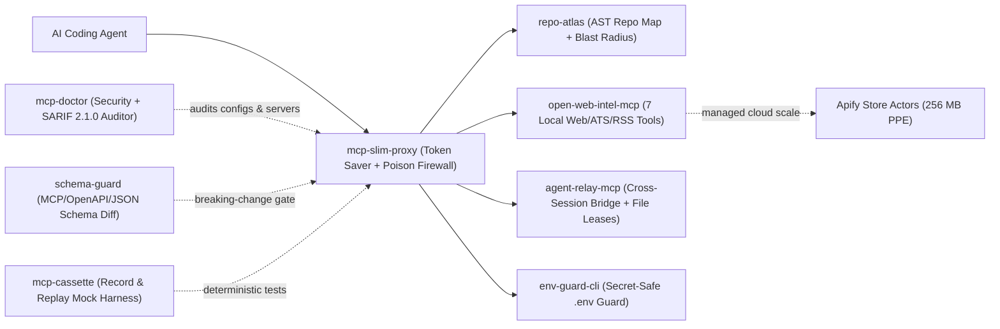

# Pakatorn Jongsirikul (`@pie527645-cloud`)

Full-stack TypeScript & Automation Developer building open-source **Model Context Protocol (MCP)** infrastructure, **local coding-agent QoL tooling**, **direct-API web data extractors** (`256 MB`, zero residential proxies), and **n8n automation workflows**.

---

## Open-Source MCP & Coding Agent Suite

| Repository | Problem Solved | Key Highlights |
| :--- | :--- | :--- |
| **[repo-atlas](https://github.com/pie527645-cloud/repo-atlas)** | Eliminates 15-call agent orientation tax & blind edits | TypeScript Compiler API AST map within token budget, Tarjan cycle detection, `--relative -z` git blast radius, CI drift check, 3 read-only MCP tools |
| **[mcp-slim-proxy](https://github.com/pie527645-cloud/mcp-slim-proxy)** | Stops 40K+ MCP tool-schema bloat & prompt injection | Multiplexes N stdio servers behind **4 lean meta-tools (`~739` tokens)**, BM25 lazy search, out-of-context `run_pipeline`, fail-closed poisoning quarantine |
| **[agent-relay-mcp](https://github.com/pie527645-cloud/agent-relay-mcp)** | Multi-agent edit collisions & terminal stdin hijacking | Zero-native atomic local store, cooperative TTL file leases, monotonic cross-session channels, non-blocking human Q&A inbox + `127.0.0.1` web UI |
| **[mcp-doctor](https://github.com/pie527645-cloud/mcp-doctor)** | Exposed secrets, tool poisoning & broken schemas in MCP | Zero runtime deps, audits configs + live stdio/HTTP servers, Context Token Tax breakdown, valid **SARIF 2.1.0** for GitHub Code Scanning |
| **[env-guard-cli](https://github.com/pie527645-cloud/env-guard-cli)** | Secret leaks, `.env` drift & agent reading `.env` raw | Zero runtime deps, polyglot TS/JS/Py/Go/Rust scanner, `.env.schema.json` validator, scrubbed `sync --write-example`, 3 secret-safe MCP tools, **SARIF 2.1.0** |
| **[schema-guard](https://github.com/pie527645-cloud/schema-guard)** | Silent breaking changes in MCP tools & OpenAPI contracts | Deterministic diff for `mcp tools/list`, OpenAPI 3.0/3.1 & JSON Schema, `diff-git` via safe `execFile`, `$defs`/`$ref` resolution, **SARIF 2.1.0** |
| **[mcp-cassette](https://github.com/pie527645-cloud/mcp-cassette)** | Flaky live MCP tests & recorded secret leaks in CI | Zero runtime deps, transparent stdio record & offline `--strict` replay mock server, pre-disk secret scrubbing, `inspect` latency/token stats |
| **[open-web-intel-mcp](https://github.com/pie527645-cloud/open-web-intel-mcp)** | Local web/B2B/ATS scraping without Chrome or proxies | 7 tools (`fetch_markdown` w/ `llms.txt`, sitemaps, 7 ATS boards, e-commerce, MX/DMARC, podcasts RSS), `undici` DNS pinning + Origin/Host-checked HTTP |
| **[apify-automation-toolkit](https://github.com/pie527645-cloud/apify-automation-toolkit)** | Interactive endpoint probing & clean workflow starters | Bilingual EN/TH client-side probers + Header-Auth n8n templates ([Live Hub](https://pie527645-cloud.github.io/apify-automation-toolkit/)) |

---

## Managed Cloud Scrapers (`Apify Store`)

Need managed cloud runs, JSON/CSV datasets, scheduling, or Pay-Per-Event APIs (`$5` free monthly platform credits included)? Browse the live public Actors on [apify.com/tsun_tsun](https://apify.com/tsun_tsun?fpr=cn0u9m):

- [Direct ATS Jobs Scraper (Greenhouse, Lever, Ashby, Workable, SmartRecruiters)](https://apify.com/tsun_tsun/ats-career-jobs-scraper?fpr=cn0u9m)
- [Workday Fortune 500 Jobs Scraper](https://apify.com/tsun_tsun/workday-jobs-scraper?fpr=cn0u9m)
- [Remote Jobs API Aggregator (Remotive, Jobicy, Himalayas, RemoteOK, WWR)](https://apify.com/tsun_tsun/remote-jobs-api-aggregator?fpr=cn0u9m)
- [Shopify Store Intelligence Scraper](https://apify.com/tsun_tsun/shopify-store-intel?fpr=cn0u9m)
- [WooCommerce Store Intelligence Scraper](https://apify.com/tsun_tsun/woocommerce-store-intel?fpr=cn0u9m)

---

## Core Stack

`TypeScript` · `Node.js` · `Model Context Protocol (MCP)` · `Zod` · `n8n` · `Apify SDK` · `GitHub Actions`
